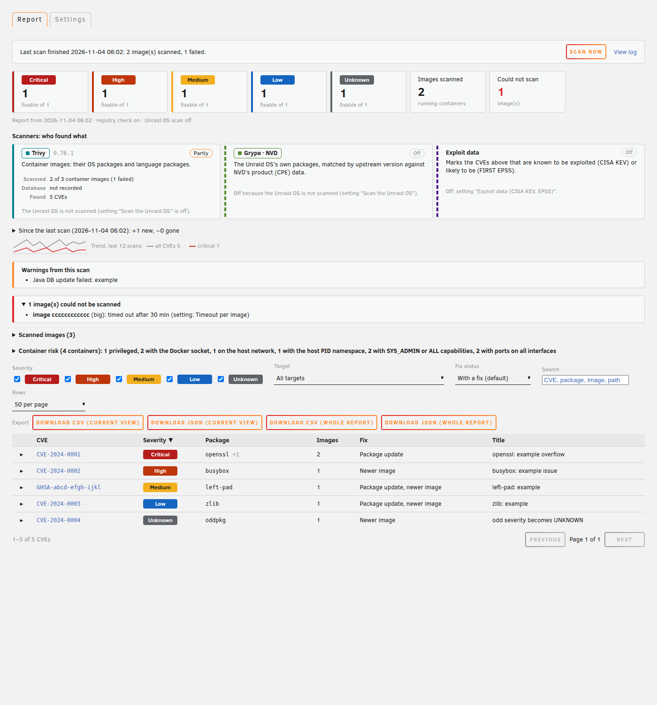
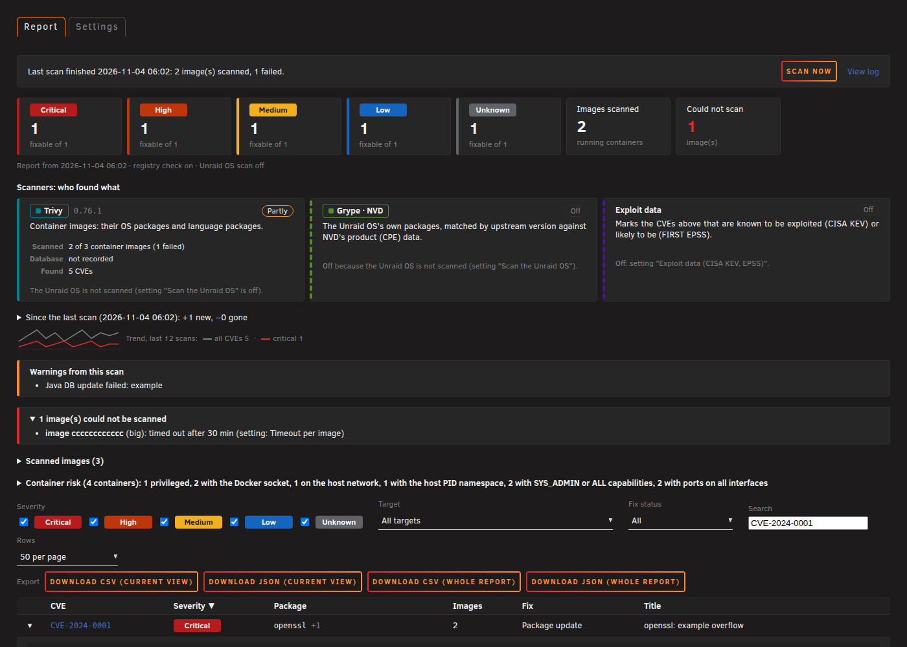
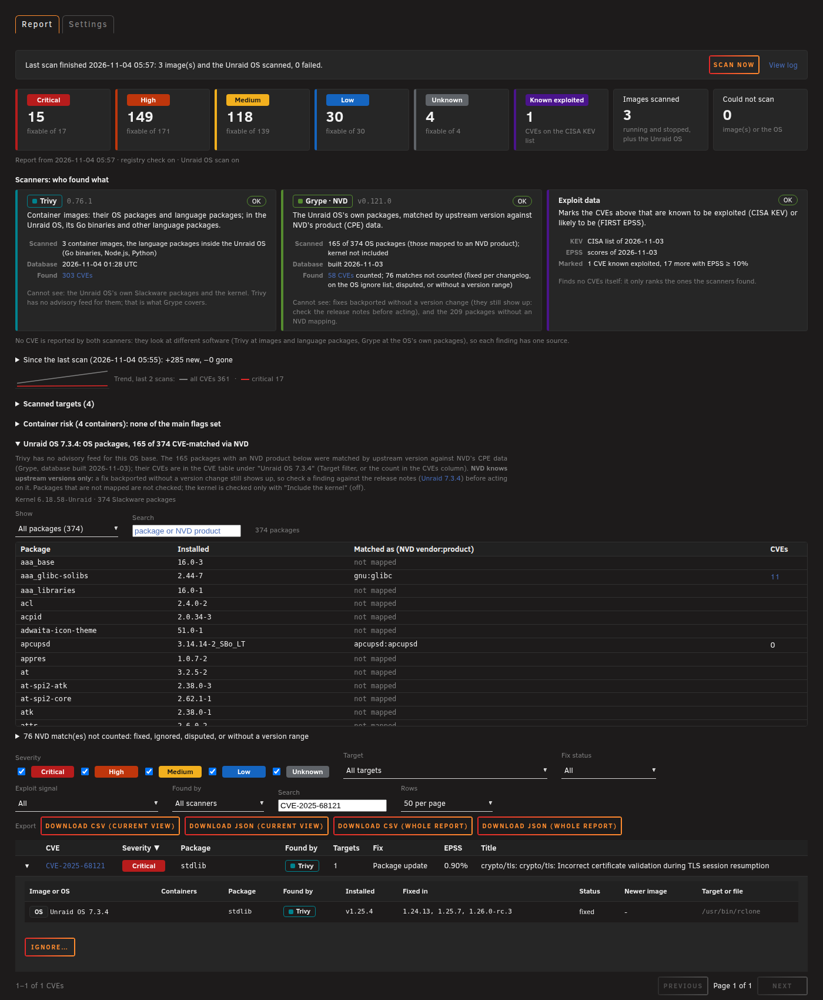
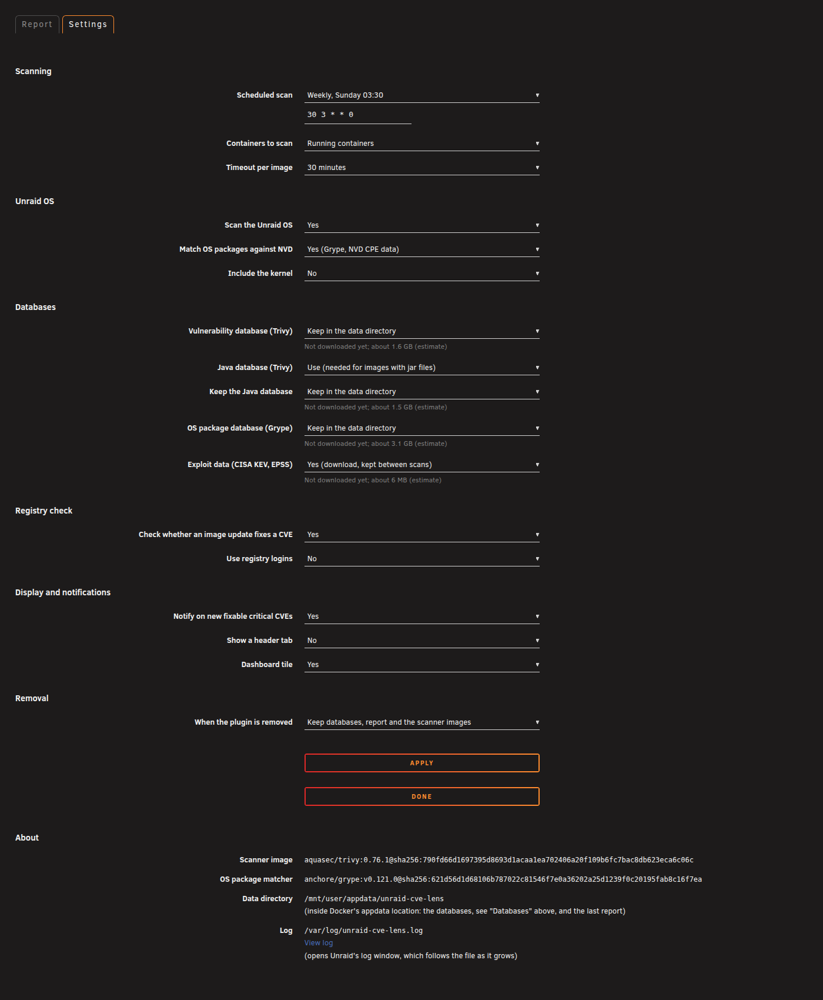
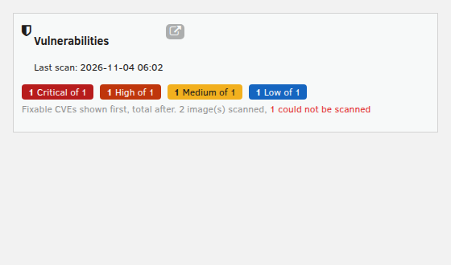
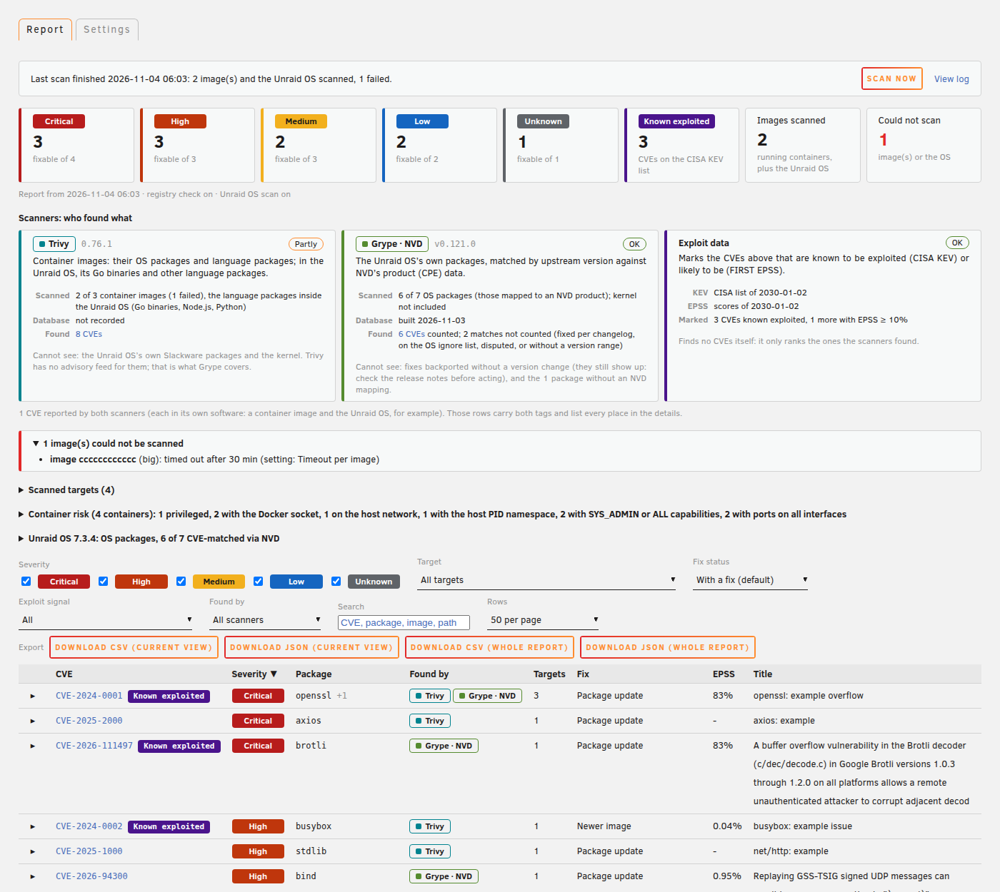
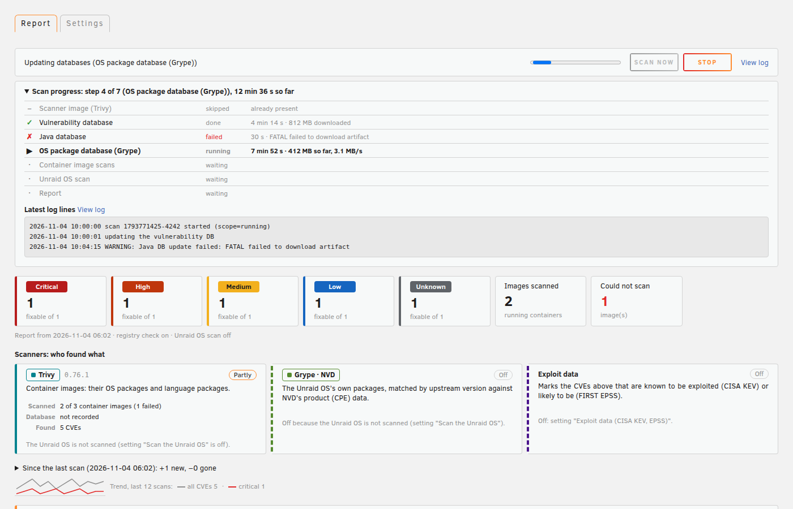
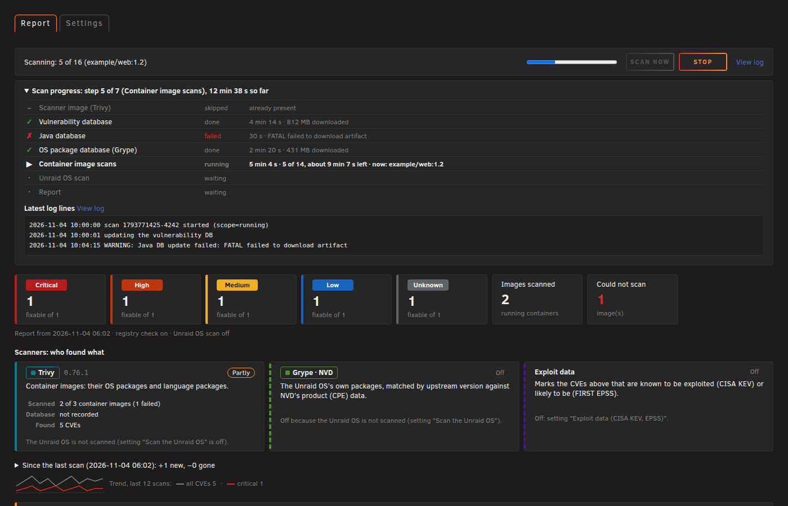

# CVE Lens for Unraid

An Unraid plugin that scans the images of your Docker containers, and the Unraid OS itself, for known
vulnerabilities with [Trivy](https://github.com/aquasecurity/trivy), and shows the result as one row per CVE: which
images (or OS files) and packages are affected, whether a package update or a newer image fixes it, and which
targets could not be scanned and why. For the OS, read [what the OS scan covers](#what-the-os-scan-covers) first:
Trivy cannot check Unraid's own Slackware packages, so they are matched against NVD's CPE data with Grype instead,
which works the same way on the coming Fedora-based Unraid 8.

| Report (light theme) | Report, one CVE expanded (dark theme) |
|---|---|
|  |  |

| Unraid OS finding and the OS package list (dark theme) | Settings (dark theme) |
|---|---|
|  |  |

| Dashboard tile |
|---|
|  |

The screenshots come from the local render harness (`tests/render/`) with Unraid's own stylesheets, showing a real
scan made by the end-to-end test: three small, deliberately old public images (`nginx:1.19-alpine`,
`alpine:3.19.1`, `alpine:3.10`) and the root filesystem of the official Unraid 7.3.4 release, extracted on the test
machine. They are not from a real Unraid server; see [Status](#status).

## Install

Plugins, Install Plugin, paste:

```
https://raw.githubusercontent.com/luuvasara/unraid-cve-lens/main/unraid-cve-lens.plg
```

Requires Unraid 7.0 or later. Nothing is scanned or downloaded at install time or at boot. Open
**Settings, CVE Lens** and press **Scan now**, or set a schedule.

The first scan downloads the pinned Trivy image (about 60 MB) and the vulnerability database (about 1.6 GB on
disk), plus about 1.5 GB for the Java database unless you turn that off, and, for the OS package match, the pinned
Grype image and its database (about 3.1 GB on disk). All of it goes to the data directory, `<Docker appdata>/unraid-cve-lens`. Under
**Settings, CVE Lens, Databases** you choose for each database whether it is kept there between scans (then it is
only refreshed when a newer build exists, about daily) or downloaded for every scan and deleted afterwards; the page
shows each one's size (on disk now, at its last download, or an estimate). Default: all three are kept (the Grype
database is a download of about 200 MB that unpacks to about 3.1 GB). See [Databases](#databases).

<!-- keep-old-begin -->
## Renamed from Trivy Scan

CVE Lens was called Trivy Scan (`unraid-trivy-scan`) until 2026.11.03. The plugin checks more than Trivy's
output now (the Unraid OS packages are matched with Grype), so the name changed. The GitHub repository was renamed
from `luuvasara/unraid-trivy-scan` to `luuvasara/unraid-cve-lens` at the same time; GitHub forwards the old
addresses, so installed copies of Trivy Scan still find their update.

What happens when you press **Check for updates** and update the Trivy Scan entry:

1. The old entry installs CVE Lens (`unraid-cve-lens.plg`) and, about a minute later, removes itself from the
   plugin list. If CVE Lens cannot be installed, the old plugin is left unchanged and the update reports the error.
2. CVE Lens copies your settings from `/boot/config/plugins/unraid-trivy-scan/` to
   `/boot/config/plugins/unraid-cve-lens/` (the settings file, the schedule, `os-ignore.txt`, `cpe-map.txt`,
   `ignore.txt`, whichever exist). The old schedule stops at once.
3. The data folder (databases, last report) is renamed from `<Docker appdata>/unraid-trivy-scan` to
   `<Docker appdata>/unraid-cve-lens` with a plain rename, so nothing is downloaded again. If the array is stopped at
   that moment, it is moved at the next boot or the next scan.
4. A scan of the old plugin that is still running is stopped and its leftover containers are removed. For one
   release CVE Lens also removes containers labelled `unraid-trivy-scan=1` when it cleans up.
5. Leftovers: the old log is added to the end of `/var/log/unraid-cve-lens.log`; earlier notifications of the old
   plugin open Settings, CVE Lens; the dashboard tile keeps its place and open/closed state. Once the old entry is
   gone, the old flash folder is removed: each file in it that is a copy of what CVE Lens has (or unchanged since
   it was copied) is deleted. A file you changed after the update, or one CVE Lens does not know, is kept, named in
   the log, and the folder stays. Unraid's record of the removed old plugin is deleted as well, so "Previous Apps"
   does not offer to install Trivy Scan again.

The settings page is now Settings, CVE Lens (`/Settings/CveLens`); the header tab is still "Vulnerabilities".
You can also install CVE Lens directly and remove the old entry by hand; the same migration runs.
<!-- keep-old-end -->

## Features

- Scans the images of running containers, or of running and stopped containers. Images are scanned by image ID,
  so a container keeps being scanned correctly after its tag has moved on (the report then says "running older
  image" and that the container needs to be recreated).
- Trivy is pinned by version **and** digest (`aquasec/trivy:0.76.1@sha256:790fd66d…c06c`, the multi-arch index
  digest, identical on Docker Hub and GHCR). A digest cannot be re-pointed, so a later push to a tag never runs on
  your server. The reference is in one place, `TRIVY_IMAGE` in `scripts/cve-lens`.
- Optional registry check: scans the image each container's tag points to in its registry today and marks the CVEs
  a newer image no longer has ("Fixed in a newer image").
- Optional scan of the Unraid OS itself (on by default): the Go programs, Node.js packages (including the Unraid
  API) and other language packages inside the OS appear as one more target, "Unraid OS 7.x.y", with the file path
  of each affected package.
- OS package match (on with the OS scan): the OS's own packages (Slackware packages on Unraid 7, RPMs on a Fedora
  base) are mapped to NVD product names (CPEs) and matched by upstream version with a pinned Grype image, because
  Trivy has no advisory feed for either base; optionally the kernel too. See
  [what the OS scan covers](#what-the-os-scan-covers).
- Which scanner found what: a "Scanners" overview under the summary has one card each for Trivy, Grype (NVD match
  of the OS packages) and the exploit data, with its version, database date, state (OK, partly, failed, off in the
  settings), what it covered, how many CVEs it reported (a link that filters the table to them) and what it cannot
  see. In the CVE table, each row and each finding in the expanded row carries a "Trivy" or "Grype · NVD" tag, and a
  "Found by" filter narrows the table to one scanner. See [Which scanner found what](#which-scanner-found-what).
- Per-target timeout. An image or OS scan that fails (timeout, unsupported content, missing Java database, ...) is
  listed with the reason instead of silently missing from the report.
- Report: one row per CVE, expandable to the affected images, containers, packages, installed and fixed versions;
  filters for severity and fix status (CVEs without any fix are hidden by default, with a count), search, sortable
  columns, paging. Every value is put into the page as text, escaped exactly once.
- Container risk: a collapsed table in the report with the settings of each scanned container that matter for
  security (privileged, Docker socket, host network or PID, added capabilities, devices, starts as root, ports on all
  interfaces, no healthcheck, `:latest`), read from `docker inspect` by the host script. Only these settings are read;
  environment values, command lines and label values never are. It lists settings, not vulnerabilities.
- A CVE that two images rate differently (for example CRITICAL in one distribution, HIGH in another) is counted
  once, at its highest severity.
- Exploit signals per CVE: a "Known exploited" badge for CVEs on CISA's Known Exploited Vulnerabilities (KEV) list,
  an EPSS column (FIRST's estimated probability of exploitation in the next 30 days), a filter "Exploited / likely"
  (KEV, or EPSS of 10% or more) and a KEV count in the summary. See [Exploit data](#exploit-data).
- End-of-life base images: an image whose base OS release is end of life (Trivy's `Metadata.OS.EOSL`) gets an
  "End of life base" badge in the scanned-targets table: that release gets no more security fixes, so findings may
  show "no fix" for that reason.
- Dashboard tile, optional header tab, Unraid notification when new fixable critical CVEs appear, and when a CVE on
  the KEV list newly affects a container image.
- Follows the active Unraid theme (black, white, gray, azure) through the theme's CSS variables.

## How it works

`scripts/cve-lens` runs every scan. It starts Trivy in short-lived containers, all labelled
`unraid-cve-lens=1` plus a per-run label, all with `--cap-drop ALL` and `no-new-privileges`:

| Role | Network | Docker socket | Databases | Registry logins |
|---|---|---|---|---|
| Database download (also the exploit data download) | yes | **no** | read-write (the exploit data download gets only its own folder) | no |
| Local image scan | **none** (`--network none`) | yes, needed to read local images | read-only | **never** |
| Registry check (optional) | yes | **no** | read-only | only with "Use registry logins" |
| Unraid OS scan (optional, on by default) | **none** (`--network none`) | **no** | read-only | **never** |
| OS package match, Grype (with the OS scan, on by default) | **none** (`--network none`, `--read-only`) | **no** | read-only | **never** |

Grype's database is downloaded by a second "database download" container (network, no socket). The match container
gets nothing of the host's filesystem: only that database, read-only, and the SBOM file the script builds from the
package list. Where it is kept: see [Databases](#databases).

The OS scan runs `trivy rootfs /rootfs`. It gets only `/usr`, `/lib`, `/lib64`, `/bin`, `/sbin` and `/opt` (when it
exists and is not a symlink), each mounted read-only under `/rootfs` with `bind-recursive=disabled`, so anything
mounted *below* them is not visible (on Unraid 7.x, `/usr` is itself an overlay on the `bzmodules` squashfs and is
included; `/lib/firmware`, a separate overlay, is not). `/lib/modules` is skipped. `/mnt` (array, pools, user
shares), `/boot`, `/etc`, `/proc`, `/sys`, `/var/lib/docker` and everything else are never mounted. `/etc` is left
out on purpose: it holds configuration and secrets, and a test scan with and without it gave the same findings.
`bind-recursive` needs Docker 25 or later; Unraid 7.0 ships Docker 27.0.3. The Slackware package list is read on the
host by the script, from `/var/lib/pkgtools/packages` (file names only), and the version from `/etc/unraid-version`.

Be clear about what this buys: whoever holds the Docker socket can ask Docker for anything, including a new
container that does have a network. Separating the roles keeps the scanner that holds the socket away from the
internet and away from your registry credentials, and keeps the network-facing containers away from the socket. It
is defence in depth, not a sandbox. Mounting the socket `:ro` would not restrict the Docker API, so the plugin does
not pretend it does.

Results are Trivy's JSON output, merged by `include/aggregate.php` into one report
(`/mnt/user/appdata/unraid-cve-lens/report/report.json`). Every string from Trivy output is treated as untrusted:
types checked, length capped, control characters removed, advisory links kept only when they are plain `https://`
URLs. The report page draws everything with `textContent`.

Stop (button, upgrade or removal) only touches containers carrying this plugin's label; other Trivy containers on
the server are left alone.

### Which scanner found what

| Card | Looks at | Cannot see |
|---|---|---|
| **Trivy** | Container images (their OS packages and language packages), and the language packages inside the Unraid OS (Go binaries, Node.js, Python, ...) | The Unraid OS's own Slackware or RPM packages and the kernel: Trivy has no advisory feed for them |
| **Grype · NVD** | The Unraid OS's own packages that have an NVD product mapping (`cpe-map.txt`), matched by upstream version | Fixes backported without a version change (they still show up), and packages without a mapping |
| **Exploit data** | Nothing by itself: marks the CVEs the scanners found as known exploited (CISA KEV) or likely to be (EPSS) | - |



The report keeps one row per CVE. A CVE that both scanners report stays one row, with both tags; the expanded row
says where each one found it (for example an OpenSSL CVE in a container image, found by Trivy, and in the Unraid OS's
`openssl` package, found by Grype). The two rarely overlap in practice: `cpe-map.txt` leaves out the Go programs and
Node.js/Python packages that Trivy already matches, so the same package is never checked by both. On a test system
with three images and Unraid 7.3.4 (361 CVEs: 303 from Trivy, 58 from Grype), no CVE was reported by both.

The "Found by" filter (shown when the OS package match ran) picks the CVEs that one scanner reported; like the other
filters it selects CVEs, so the expanded row and the export of the current view still list every finding of those
CVEs, each with its own source. `#src=trivy` or `#src=cpe` in the page address opens the table with that filter.

`report.json` carries the counts as `summary.by_source` (`trivy`, `cpe`, `both`: CVEs, not findings) and the state of
the exploit data as `exploit.state` (`ok`, `partial`, `failed`, `off`) and `exploit.kev_source` (`cisa`, or `grype`
when only Grype's database had KEV data).

### Databases

| Database | Directory | Setting | Not kept |
|---|---|---|---|
| Trivy vulnerability DB | `<data dir>/cache/db` | `TRIVY_DB_KEEP` (default `yes`) | downloaded into the same place, deleted when the run ends |
| Trivy Java DB | `<data dir>/cache/java-db` | `JAVA_DB_KEEP` (default `yes`) | same |
| Grype DB (OS package match) | `<data dir>/grype` | `OS_PKG_DB_KEEP` (default `yes`) | downloaded into `<data dir>/grype-run`, deleted when the run ends |
| Exploit data (KEV, EPSS) | `<data dir>/exploit` | `EXPLOIT_DATA` (default `yes`; always kept, `no` deletes it) | not applicable |

The two Trivy databases share Trivy's one cache mount, which is not split (Trivy may move files within it), so a
Trivy database that is not kept is removed after the run rather than placed elsewhere. "Update database" refreshes
only the databases that are kept. The size of each database after its last download is noted in
`<data dir>/db-sizes` for the settings page.

### Exploit data

Two small public files, downloaded with the databases by a "database download" container (network, no Docker
socket, `--read-only`, only `<data dir>/exploit` mounted, the pinned Trivy image's BusyBox `wget`, so no extra image):

| File | Source | Size |
|---|---|---|
| `kev.json` | CISA Known Exploited Vulnerabilities, `https://www.cisa.gov/sites/default/files/feeds/known_exploited_vulnerabilities.json` | about 2 MB |
| `epss.csv.gz` | FIRST EPSS, daily file `https://epss.empiricalsecurity.com/epss_scores-YYYY-MM-DD.csv.gz` (FIRST's page points to Empirical Security; the older `epss.cyentia.com` address redirects there) | about 3 MB |

A download is capped at 50 MiB and checked (format, gzip) before it replaces the previous copy; if it fails, the last
good copy stays and the scan warns. The files are kept between scans and only fetched when the databases are
updated. `aggregate.php` joins them to the CVEs and treats every field as untrusted (CVE id, date and number formats
are validated; at most 20,000 KEV entries and 1,000,000 EPSS lines are read; a file over 50 MiB is ignored). For the OS package
match, Grype's own `knownExploited` and `epss` fields (its database carries both) are used where the files give
nothing. Per CVE the report has `kev` (`{added, ransomware}` or `null`), `epss` and `epss_pct` (0 to 1, or `null`
when there is no score). A CVE that newly appears on the KEV list and affects a container image triggers the
notification; OS findings (Trivy or NVD CPE matches) do not, and nothing is "new" when the previous report had no
KEV data. Turn all of this off with `EXPLOIT_DATA=no`.

## What the OS scan covers

Unraid OS is based on Slackware. Trivy (checked in the v0.76.1 source and docs, 2026-10-31) has **no Slackware
support**: its OS list is Alpine, Wolfi, Chainguard, MinimOS, RHEL, CentOS, AlmaLinux, Rocky, Oracle, Azure Linux,
Amazon Linux, openSUSE/SLES, Photon, CoreOS, Echo, Debian, Ubuntu and Bottlerocket, and its OS package analyzers are
apk, dpkg, rpm and Bottlerocket only. In a test run that included Unraid's `/etc/os-release` (`ID=unraid-os`,
`ID_LIKE=slackware`), Trivy detected no OS at all, and the findings were the same as without `/etc`.

| | Checked against CVEs? |
|---|---|
| Go binaries in the OS (embedded module list and Go version), e.g. `docker`, `dockerd`, `containerd`, `ctr`, `runc`, `docker-proxy`, `docker-buildx`, `rclone` | **yes** |
| Node.js packages (`package.json` in `node_modules`), e.g. the Unraid API in `/usr/local/unraid-api` and the bundled npm | **yes** |
| Other installed language packages Trivy reads in rootfs mode: Python wheels/eggs, PHP Composer `installed.json`, Ruby gemspecs, Java jars, .NET, Rust (`Cargo.lock`, cargo-auditable binaries), Julia | **yes**, where present (Unraid 7.3.4 has none of these that Trivy reports) |
| Files installed by plugins under `/usr` or `/opt` (Go binaries, `node_modules`, ...) | **yes**, same rules |
| The Slackware packages (`bash`, `openssl`, `openssh`, `samba`, `nginx`, `php`, `qemu`, `glibc`, ... about 370 in 7.3.4) | **by Trivy, no**; **by the OS package match, yes** for those with a CPE mapping (see below) |
| The Linux kernel | only with "Include the kernel" (off by default) |
| C/C++ programs and libraries outside any package manager | **no** |

### The OS package match (Slackware now, Fedora later)

Trivy needs a distribution advisory feed to check OS packages, and there is none it can use for Slackware or for
Fedora / Fedora CoreOS (see below). Both bases ship mostly unmodified upstream versions, though, and NVD records the
affected upstream version ranges of each CVE as CPE configurations. So the plugin matches by upstream name and
version, the same way on both bases:

1. **Inventory, on the host.** Slackware: the file names in `/var/lib/pkgtools/packages`. RPM (Unraid 8): `rpm -qa`
   with each package's source RPM name, plus the changelogs. Which one is used is decided by what exists, not by a
   version check, so nothing has to change when Unraid 8 ships.
2. **Mapping** (`include/osinventory.php`). Package names (Slackware names or RPM source names; RPM sub-packages such
   as `openssl-libs` fold into their source package) are mapped to NVD `vendor:product` pairs from
   `include/cpe-map.txt`, about 200 entries. The result is a CycloneDX SBOM with one CPE 2.3 per package and version.
   Packages without a mapping are not guessed: a wrong vendor/product pair gives false findings. They are listed in
   the report, unchecked. Go programs and Node.js packages are left to the Trivy scan, which reads their exact
   module versions.
3. **Matching.** The pinned `anchore/grype` image (version and index digest in `GRYPE_IMAGE`, `scripts/cve-lens`)
   matches the SBOM against its NVD data, offline.
4. **Backports.** NVD only knows upstream versions, so a fix backported into the same version is still reported.
   On RPM systems, a CVE id named in the package's changelog is taken as fixed (that is how Fedora documents
   backports). On either base, `/boot/config/plugins/unraid-cve-lens/os-ignore.txt` hides CVEs: one per line,
   `CVE-2025-1234 [package] [# note]`. The report lists every hidden match and the reason.
5. **Entries NVD cannot place.** Some NVD records name a product but no version range, so Grype reports them for
   every version ("none (unknown)" in its output), and some carry NVD's `** DISPUTED **` marker. Neither says
   anything about the installed version, so they are not counted as findings and are listed with that reason
   instead. On the 7.3.4 release files this is 76 of 160 Grype matches (for example a 2008 OpenSSH entry, and
   disputed glibc entries). A match is set aside only when every match for that CVE and package says so.
6. **Notifications.** OS package matches never trigger the "new fixable critical" notification: the packages come
   with Unraid and cannot be updated on their own, and a fix may already be backported. They are in the report.

Local additions: `/boot/config/plugins/unraid-cve-lens/cpe-map.txt`, same format as the shipped file; a line there
replaces the shipped one for that name, and `<name> -` switches a mapping off.

Limits, plainly: the match is only as good as NVD's CPE data (NVD's analysis backlog since 2024 means some recent
CVEs have no CPE configuration yet and are not found), the mapping covers the packages most likely to matter rather
than all ~370, and Slackware/Lime Tech backports are not visible to it. Treat a finding as "check the release notes",
not as proof. The report still links the Unraid release notes from the OS package list.

### Unraid 8 will not close this gap by itself

Lime Technology announced on 2026-08-17 that Unraid 8 moves from Slackware to a Fedora base built on Universal
Blue's uCore ([announcement](https://unraid.net/blog/unraid-8-announced)); there is no release date yet ("it'll
ship when it's ready"). uCore is built on Fedora CoreOS, so the OS packages will be RPMs that Trivy can at least
list. Trivy still cannot check them against CVEs, though:

- Trivy's coverage page for CoreOS, which covers Fedora CoreOS, says SBOM ✓ and Vulnerability "-" (not supported)
  ([v0.76.1 docs](https://github.com/aquasecurity/trivy/blob/v0.76.1/docs/guide/coverage/os/coreos.md)).
- Fedora itself is not on Trivy's list of supported operating systems. The request "Support Fedora"
  ([aquasecurity/trivy#121](https://github.com/aquasecurity/trivy/issues/121)) has been open since 2019-08-19 and
  is labelled `help wanted`. The blocker discussed there is that Fedora publishes no structured,
  machine-readable advisory feed like RHEL's.

This is why the OS package match above does not rely on a Fedora feed: on an RPM base it reads the RPM database
(`/usr/lib/sysimage/rpm`, `/var/lib/rpm` or `/usr/share/rpm` under the root) through `rpm`, and the same CPE matching
applies. The RPM path is tested with recorded `rpm -qa` output only; the mounted directories of the Trivy scan will
have to be checked again for an image-based layout once a beta is available. The Go and Node.js coverage does not
depend on the base distribution.

What a scan of the official 7.3.4 release found (test machine, 2026-10-31, vulnerability DB of that day) is in
[Status](#status).

## Ignoring findings

`/boot/config/plugins/unraid-cve-lens/ignore.txt` (next to the settings file) hides findings you have judged
harmless, with a reason and an optional expiry. One entry per line:

    CVE-ID [scope] [until=YYYY-MM-DD] [# reason]

- `scope` is `*` (everywhere, the default), `os` (the Unraid OS), or an image name. Without a tag
  (`lscr.io/linuxserver/plex`) it covers every tag; with one (`nginx:1.19-alpine`) only that tag. For Docker Hub the
  `docker.io/library/` prefix may be left out. Names are not matched by prefix or suffix.
- After `until` (the day itself still counts) the entry hides nothing and the report lists it as an expired ignore,
  with the number of findings that are counted again, so it does not go unnoticed.
- A line that cannot be read is counted and listed with its line number; it is never dropped silently.
- Ignored findings are left out of the counts (the Known exploited count too) and never trigger a notification (new
  fixable critical, new known exploited). They are listed under "Ignored"
  in the report (CVE, scope, image, reason, until). An ignored CVE that expires is a new finding again: the next scan
  notifies it (once) under the same rules as any new finding, so an accepted risk is looked at again.
- In an expanded CVE row, "Ignore..." writes a line here (scope: one of the affected images, or all), and
  "Stop ignoring" in the Ignored list removes it. The page and the scan share one parser; the file is capped at
  256 KiB and 5000 lines, and is replaced atomically.
- A change applies at the next scan: the scan results are removed once the report is built, so the report cannot be
  rebuilt without scanning again.
- `os-ignore.txt` (CVE and package, OS package matches only, see Backports) keeps working as before.

## Report export and history

- Export, above the CVE table: CSV or JSON of the current view (search and filters applied) or of the whole report,
  saved by the browser as `cve-lens-report-<date>[-filtered].csv|json`. The CSV has one row per CVE and affected
  package in a target (its `source` column is `trivy` or `cpe`, the same two values as the "Found by" filter;
  `cpe` is Grype's NVD match of the OS packages), starts with a UTF-8 byte order mark so spreadsheet programs read it correctly, and neutralises cells that
  start with `=`, `+`, `-`, `@`, a tab or a carriage return so a spreadsheet does not run them as formulas.
- Since the last scan: the CVEs that are new, and the ones that are gone. A CVE counts as gone only when every target
  it affected was scanned successfully again, so a failed or skipped image does not make its findings look fixed.
- `history.jsonl` next to `report.json` (`<data dir>/report/`): one line per scan with the time, the counts per
  severity, fixable, images, failed, the OS CVE count and a hash of the CVE list. The last 90 scans are kept; the
  report shows the last 30 as a small trend line (all CVEs and critical ones). The file holds no CVE details, so it
  can be deleted at any time; the trend starts again from the next scan.

## Progress and the log

While a scan or a database update runs, the report page shows a progress panel under the status bar (collapsible,
open while a run goes on):

- every step of the run in order, each marked done, running, waiting, skipped or failed, with its duration: scanner
  image downloads, each enabled database update (vulnerability DB, Java DB, Grype DB, exploit data), the image scans,
  the Unraid OS scan, the OS package match, the registry check and the report. A failed step shows its reason;
  steps a failed or stopped run never reached are marked skipped;
- for downloads, how much has been written so far and the current rate (for example "412 MB so far, 3.1 MB/s");
- for the image scans, "n of m", the image being scanned and an estimate of the time left from the average per
  image so far;
- the total time so far and the latest lines of this run's log.

When no run is going on, the panel (collapsed) summarises the last run: result, when it ended, how long it took and
each step's duration.

"View log" (status bar, progress panel, Settings "About", and the dashboard tile after a failed run) opens Unraid's
own log window, which follows `/var/log/unraid-cve-lens.log` as it grows. Where that window is not available it
opens `include/log.php`, the last 500 lines of the same file as plain text; that endpoint takes no parameters and
cannot read any other file.

How it is measured, kept light for slow servers: the scan script writes the steps with their start and end times to
`/var/run/unraid-cve-lens/steps` (a RAM disk) and copies them to `<data dir>/report/last-steps` when the run ends.
During a download a sampler adds up, every 2 s, the sizes of the few files that download is writing: Trivy's
temporary download directory (`<data dir>/dl-tmp`, mounted as the database container's `/tmp`, deleted afterwards),
Grype's `tmp` folder, the exploit data's `.new` files, or Docker's blob downloads for an image pull
(`/var/lib/docker/tmp/GetImageBlob*`, or containerd's `ingest` folder). The page asks for the state every 3 s while a
run goes on and every 30 s otherwise; each request reads only these small files and the end of the log.

|  |  |
|---|---|

## Settings

Stored on the flash drive in `/boot/config/plugins/unraid-cve-lens/unraid-cve-lens.cfg` as plain
`KEY="value"` lines. The file is read as data, never executed, both by the scan script and by the pages. Every
value is checked when the form is saved (the save is refused if anything is invalid) and again whenever it is read
(an invalid value falls back to its default and the settings page says so).

| Key | Values | Default |
|---|---|---|
| `SCHEDULE` | empty (no schedule) or a 5-field cron expression, digits and `* , - /` only, range-checked | empty |
| `SCOPE` | `running`, `all` | `running` |
| `TIMEOUT` | minutes per image (and for the OS scan), 5 to 240 | `30` |
| `JAVA_DB` | `yes`, `no` (use the Java database, needed for images with jar files) | `yes` |
| `TRIVY_DB_KEEP` | `yes`, `no` (keep the Trivy vulnerability database between scans; `no`: download it for every scan) | `yes` |
| `JAVA_DB_KEEP` | `yes`, `no` (the same for the Java database) | `yes` |
| `REGISTRY_CHECK` | `yes`, `no` | `no` |
| `REGISTRY_AUTH` | `yes`, `no` (mount `/root/.docker/config.json` read-only into the registry-check container) | `no` |
| `NOTIFY` | `yes`, `no` | `yes` |
| `OS_SCAN` | `yes`, `no` (also scan the Unraid OS, see above) | `yes` |
| `OS_PKG_MATCH` | `yes`, `no` (with `OS_SCAN`: match the OS packages against NVD with Grype) | `yes` |
| `OS_PKG_DB_KEEP` | `yes`, `no` (with `OS_PKG_MATCH`: keep Grype's database between scans; `no`: download it for every scan) | `yes` |
| `EXPLOIT_DATA` | `yes`, `no` (download CISA KEV and FIRST EPSS, kept between scans, and show them per CVE; see [Exploit data](#exploit-data)) | `yes` |
| `OS_KERNEL_MATCH` | `yes`, `no` (with `OS_PKG_MATCH`: include the kernel) | `no` |
| `SHOW_TAB` | `yes`, `no` | `no` |
| `DASH_TILE` | `yes`, `no` | `yes` |
| `REMOVE_DATA` | `yes`, `no` (on removal, delete the data directory and the pinned Trivy and Grype images) | `no` |

An invalid schedule never reaches cron; with no valid schedule there is no cron entry.

## Lifecycle

- Install and boot: create the runtime directory and write (or remove) the cron entry from the saved settings.
  No scan, no download.
- Upgrade: a running scan is stopped before its script is replaced.
- Removal: a running scan is stopped and the cron entry removed. With "When the plugin is removed" set to delete,
  the data directory (fixed path, only if it is a real directory and not a symlink) and the pinned Trivy and Grype images are
  removed too. The settings file on the flash drive is kept.

## Command line

```
/usr/local/emhttp/plugins/unraid-cve-lens/scripts/cve-lens start|stop|status|update-db|apply|config|image
```

Log: `/var/log/unraid-cve-lens.log` ("View log" on the report and settings pages, see [Progress and the log](#progress-and-the-log)).

## Building and testing

```
./build.sh                 # packages/unraid-cve-lens-<version>-x86_64-1.txz + .md5, fills &md5; in the .plg
tests/run-tests.sh         # lint, unit and render tests (offline)
tests/run-tests.sh --e2e   # plus the end-to-end test against the local Docker
```

Version scheme: `YYYY.MM.DD` plus an optional letter; bump `&version;` in the .plg for every change.

- `tests/lint.sh`: shellcheck (style level, `koalaman/shellcheck:stable` run without network) on all scripts and on
  the .plg's inline blocks with entities resolved; `php -l`; `node --check`; page headers.
- `tests/unit.sh`: cron validation (the bash and PHP validators agree on every case), the settings readers against
  hostile files (command substitution, `; cmd`, newline injection, CRLF, unknown keys), `validate.php` in
  `update.php`'s scope, `apply`, `uninstall` guards, .plg lifecycle rules, and the aggregator on hand-written
  Trivy JSON fixtures (`tests/aggregate-test.php`). A fake `docker` is used, no container is touched.
- `tests/render/render-test.sh`: serves the pages from `php -S 127.0.0.1` through a small router that mimics
  Unraid's page layout, with Unraid's stylesheets (`fetch-webgui.sh`, pinned upstream commit, not stored here).
  Standalone headless Chrome checks that hostile strings in every field show up as text escaped exactly once and
  that nothing executes, tests the action endpoint (method, CSRF token, action list) and takes the screenshots.
- `tests/e2e.sh`: real scans on the local Docker with the pinned image and small old public images: running and
  stopped scope, scan by image ID, registry check with an outdated tag, the container roles (from a logging docker
  shim), a simulated per-image timeout, stop scoped to the plugin's label (an unlabelled container from the same
  Trivy image survives), the lock, `update-db`. It removes the containers and images it added.
  The Unraid OS scan runs against a local copy of an official release: `tests/unraid-os.sh` downloads the release
  zip from Lime Tech's release server (version, URL and SHA-256 pinned in the script), checks it and the per-file
  `.sha256`, and extracts `bzroot` and `bzmodules` (the `/usr` squashfs) into `tests/.work/unraid-os/root`
  (about 2.7 GB). Checked: mounts and container role, findings with file paths, the package inventory, a simulated
  OS-scan timeout.

## Status

Tested on a Linux workstation only: unit, render and end-to-end tests pass there (Docker 29 with the containerd
image store). **Not yet tested on a real Unraid server.** Still to check there: the webGUI integration (tabs,
Settings form through `update.php`, CSRF handling, the dashboard tile and header tab), `update_cron` and `notify`,
Unraid's Docker image store, and the OS scan on a running server (it was tested on the extracted 7.3.4 release
files, owned by the test user, not on a live root filesystem with plugins installed).

OS scan of the official Unraid 7.3.4 release files (2026-10-31, Trivy 0.76.1, vulnerability DB of that day):
227 distinct CVEs in 476 findings across 40 files: 8 critical, 107 high, 91 medium, 17 low, 4 unknown; all but 5
have a fixed version upstream. By file: `/usr/bin/rclone` 119 CVEs, the Unraid API's `node_modules` 68, the bundled
npm (`/usr/local/lib/node_modules/npm`) 39, `containerd` 36, `ctr` 28, `containerd-shim-runc-v2` 22,
`docker-buildx` 22, `dockerd` 19, `runc` 19, `docker-proxy` 16, `docker` 14. The critical ones are in rclone
(v1.72.0: rclone's own CVEs, gRPC, and the Go 1.25.4 standard library it was built with) and node-tar inside the
bundled npm. A finding means the installed version is in an affected range, not that it can be exploited on your
server: several of the rclone CVEs, by their own titles, need rclone's remote-control server to be enabled. Fixing
them is up to Lime Tech (a newer Unraid release), not something to patch by hand.

The OS package match is covered by the offline tests (`tests/osinventory-test.php`: Slackware list, RPM query with
changelogs, user map; `tests/aggregate-test.php`: hand-written Grype output; `tests/unit.sh`: container role and
mounts through a fake `docker` and a fake `rpm`) and has run on one real Unraid 7 server (Grype database download,
411 Slackware packages of which 124 mapped, matched without error). It has not yet been run against the 7.3.4
release files in `tests/e2e.sh`, so the number of findings it gives there is not recorded here.

## Thanks

Thanks to Xaero for the original cve-lens plugin on the Unraid forums, which this one is built on.

## License

GPL-2.0, see [LICENSE](LICENSE). Trivy is a separate project by Aqua Security under the Apache License 2.0; this
plugin does not include it, it runs the published image.
